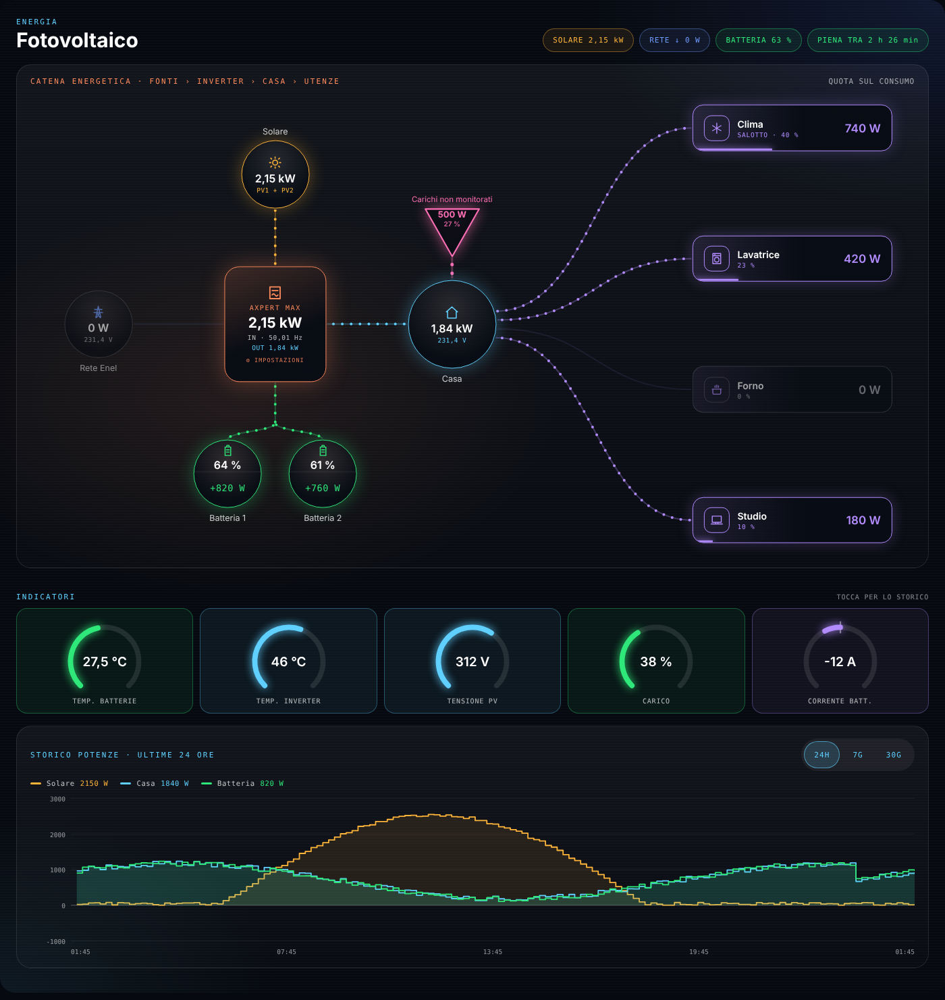
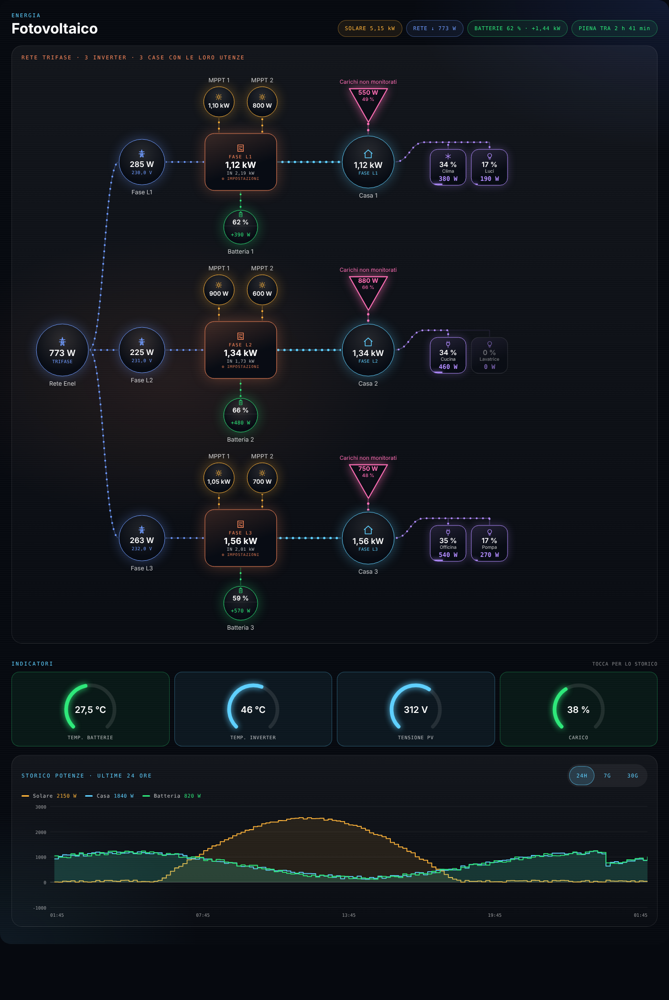

# FV HUD Card

Card Lovelace a tutta pagina per Home Assistant: monitoraggio del **fotovoltaico** in stile HUD, con flusso di energia animato, indicatori con soglie colorate, storico e pannello di controllo dell'inverter **Axpert** (o di qualsiasi inverter che esponga entità `select`, `number` e `switch`).

N.B. LA CARD È SVILUPPATA PER ESSERE INSERITA IN UNA SCHEDA A VISUALIZZAZIONE SINGOLA

Se la card ti è utile, puoi offrirmi un caffè:

[](https://www.paypal.me/Memme198926)




## Funzioni

- **Flusso di energia animato**: solare → inverter → casa, rete, una o due batterie e le utenze, con la quota di ciascuna sul consumo e il triangolo dei **carichi non monitorati**.
- **Singolo o multi inverter**: modalità con un inverter (fino a 4 MPPT, 1-2 batterie, **10 utenze**) oppure fino a 3 inverter, uno per fase, ciascuno con fino a 4 MPPT e **12 utenze** (36 in totale). Supporta anche una batteria unica condivisa fra più inverter.
- **Sottocarichi**: ogni utenza può avere fino a 6 sottocarichi che ne dettagliano il consumo, ciascuno con il suo storico.
- **5 lingue**: italiano, inglese, spagnolo, francese e tedesco. La card segue la lingua di Home Assistant, oppure la scegli dall'editor.
- **Popup con grafico** per ogni cerchio e utenza: potenza, tensione, corrente e carica (SOC).
- **Allerta entità non valide (opzionale)**: un triangolo giallo compare sul cerchio o riquadro quando Home Assistant segnala l'entità come `unavailable`, `unknown`, vuota o inesistente. Si attiva per sezione (Rete, MPPT, Batteria, Casa e utenze) da *Allerta entità* nell'editor (`alerts`).
- **Indicatore «AGGIORNATO … fa» nel popup**: mostra da quanto tempo è stato aggiornato il dato (secondi, minuti, ore), con puntino verde se appena aggiornato.
- **Pulsante di comando nel popup**: ogni utenza e ogni sottocarico può avere un'entità da comandare (switch, luce, input_boolean, ventilatore, automazione, script, scena, pulsante). Il popup mostra un pulsante per accendere/spegnere, o per avviare nel caso di pulsanti, script e scene, con i nomi che scegli.
- **Fino a 3 carichi di carica (auto)** per ogni utenza, ad esempio una wallbox con più auto: ognuno ha il suo SOC e un nome a scelta, una scheda nel popup e, sul riquadro, i valori che si alternano ogni 5 secondi (AUTO 1, AUTO 2, AUTO 3).
- **Energia per periodo (kWh)**: nel popup di fonti, batterie, rete, casa e utenze compare un istogramma con l'energia del **giorno, della settimana, del mese e dell'anno**, con navigazione fra i periodi, scelta della data, confronto con il periodo precedente, totali e saldo (prelievo / immissione, carica / scarica). Richiede un contatore in kWh (vedi sotto). Con più MPPT o con due batterie puoi usare anche un contatore **totale**: sul punto dove le linee si uniscono compare un pallino cliccabile che apre l'energia complessiva.
- **Costi e bolletta (opzionale)**: stima in tempo reale della prossima bolletta della luce (prezzo fisso, biorario, notte e festivi o a fasce F1/F2/F3 con orari ARERA), proiezione a fine periodo, storico delle bollette (anche compilato in automatico a fine periodo) con confronto con la bolletta precedente, più il **ricavo dell'energia immessa in rete**. Si attiva dall'editor, sezione *Costi e bolletta* (vedi sotto).
- **Tempo stimato** di carica completa o di scarica fino alla carica residua desiderata (imposta la capacità del pacco batterie).
- **Indicatori** (fino a 18): anelli o tessere con barra, colori a soglie, scale che attraversano lo zero (es. correnti).
- **Storico** al tocco su qualsiasi indicatore o utenza (24 ore, 7 e 30 giorni), con tooltip.
- **Grafico storico potenze** a più serie (fino a 6).
- **Pannello inverter**: impostazioni (`select` / `number`), interruttori e letture, con **PIN** opzionale e blocco automatico.
- **Editor visuale completo**: non serve scrivere YAML.
- Adattiva: schermo largo, tablet e telefono.

## Novità per versione

Qui trovi cosa è stato introdotto in ogni versione, dalla più recente alla più vecchia.

### v1.51.2
Include anche le modifiche della 1.51.1 (non pubblicata).
- **Popup bollette più leggibile**: sotto le barre dello storico compare il periodo completo (es. `MAR–APR` per un bimestre, `MAR` per un mese), nella lingua della card, al posto del solo primo mese.
- Tolto il riquadro «Costo medio» e la colonna del costo al kWh nell'elenco, per fare spazio ai dati principali (totale 12 mesi ed energia prelevata).

### v1.51.0
- **Storico bollette automatico**: a fine periodo la bolletta chiusa viene aggiunta da sola allo storico come **STIMATA** (calcolata dalle statistiche del contatore con i prezzi impostati, anche se la card non era aperta quel giorno). Se hai impostato la data di partenza, la card recupera anche i periodi già chiusi dopo quella data. Si conservano al massimo 12 mensili o 6 bimestrali, scartando le più vecchie.
- Le bollette stimate sono salvate nell'archivio dati utente di Home Assistant (per utente, valide su tutti i suoi dispositivi) e si vedono nell'editor (*Costi e bolletta → Storico bollette*): modificandone una con l'importo reale diventa una bolletta inserita a mano. Quelle inserite a mano hanno sempre la precedenza sulle stimate dello stesso periodo.
- Nel popup e nel grafico le bollette stimate sono riconoscibili dall'etichetta «STIMATA» e dal bordo tratteggiato.

### v1.50.0
Include tutte le novità dalla 1.30.0 (le versioni intermedie non sono state pubblicate).
- **Costi e bolletta** (nuova sezione dell'editor, `economy`), tutto opzionale:
  - **Stima della prossima bolletta in tempo reale**: un chip `€ BOLLETTA …` in alto apre il popup con il totale finora, la voce per voce (energia per fascia, rete e oneri, quota fissa, quota potenza, accisa, IVA, canone TV), la barra del periodo e la **proiezione a fine periodo** al ritmo attuale. Con più fasi mostra anche il prelievo per fase.
  - **Tipi di contratto**: prezzo fisso, biorario (F1/F23), notte e festivi, a fasce (F1/F2/F3). Orari **standard ARERA** (festivi italiani e lunedì di Pasqua inclusi) oppure personalizzati.
  - **Fatturazione mensile o bimestrale**, con data di partenza del calcolo.
  - **Storico bollette** inserito a mano (fino a 12 mensili o 6 bimestrali): istogramma, confronto con la bolletta precedente, totale, kWh e costo medio al kWh.
  - **Ricavo dell'energia immessa in rete**: sotto il cerchio Rete compaiono i kWh immessi oggi, nel popup della Rete il ricavo, in base al prezzo scelto.
  - Valuta personalizzabile.
- Interfaccia tradotta in 5 lingue anche per le nuove funzioni.

### v1.30.0
- **Allerta entità non valide** (opzionale): triangolo giallo su cerchi e riquadri quando un'entità è `unavailable`, `unknown`, vuota o inesistente. Si attiva per sezione (Rete, MPPT, Batteria, Casa e utenze) da *Allerta entità* nell'editor (`alerts`).
- **Indicatore «AGGIORNATO … fa»** nel popup: da quanto tempo è stato aggiornato il dato.
- I campi SOC delle utenze compaiono nell'editor solo con l'icona auto.
- Grafica: le barre restano ritagliate dal bordo, i triangoli possono sporgere.

### v1.29.0
- **Pulsante di comando nel popup** di un'utenza (`action_entity`, `action_name`, `action_name_on`), per accendere/spegnere o inviare un comando.
- Corretto: il pulsante non veniva disabilitato per entità `button` / `input_button` in stato `unknown`.

### v1.28.0
- **Fino a 3 carichi di carica (auto)** per utenza, con nome personalizzabile per ciascun SOC (`soc_name`).

### v1.27.x
- **Contatori totali di energia**: somma di tutti gli MPPT (`solar.energy_total_entity`) e delle batterie (`battery.energy_total_in_entity`, `energy_total_out_entity`) per un'energia per periodo più precisa.

### v1.26.0
- **Energia per periodo**: grafico a barre con navigazione tra i periodi, scelta della data e dettaglio al tocco, basato sui contatori kWh (`energy_entity`, `energy_in_entity`, `energy_out_entity`) di produzione, rete, batterie e utenze.

### v1.25.x
- **Interfaccia e editor in 5 lingue** (italiano, inglese, spagnolo, francese, tedesco) con selettore della lingua.

### v1.24.0
- **Fino a 4 MPPT** (prima 2), sia in modalità singolo inverter sia in multi inverter (fino a 4 MPPT per ciascun inverter), con layout adattato anche su schermi stretti.
- Campo della potenza di ogni MPPT nell'editor.

### v1.23.0
- Prima release pubblica: modalità singolo inverter e multi inverter.

## Lingue

L'interfaccia della card (card, editor visuale, popup e messaggi) è disponibile in **5 lingue**:

| Lingua | Codice |
|---|---|
| Italiano | `it` |
| English | `en` |
| Español | `es` |
| Français | `fr` |
| Deutsch | `de` |

Per impostazione predefinita la card usa la lingua di Home Assistant. Per forzarne un'altra: editor visuale → **Generale → Lingua**, oppure `language: en` in YAML. Se la lingua di Home Assistant non è fra queste, viene usato l'inglese.

## Installazione

### Con il Marketplace di Home Assistant (2026.11 o successivo)

Dalla versione 2026.11 HACS è integrato in Home Assistant come **Marketplace**.

1. Impostazioni → **Marketplace** → menu ⋮ → **Aggiungi da link**.
2. Incolla `https://github.com/Memme1989/fv-hud-card`, categoria **Dashboard**, poi **Aggiungi**.
3. Cerca **FV HUD Card** e premi **Scarica**.
4. Ricarica il browser (Ctrl+F5).

### Con HACS (versioni precedenti di Home Assistant)

1. HACS → menu ⋮ → **Repository personalizzati**.
2. Incolla `https://github.com/Memme1989/fv-hud-card`, categoria **Dashboard** (o *Lovelace*), poi **Aggiungi**.
3. Cerca **FV HUD Card** e premi **Scarica**.
4. Ricarica il browser (Ctrl+F5).

### Manuale

1. Scarica `fv-hud-card.js` dall'ultima [release](https://github.com/Memme1989/fv-hud-card/releases) e copialo in `/config/www/`.
2. Impostazioni → Dashboard → ⋮ → **Risorse** → aggiungi `/local/fv-hud-card.js` come **Modulo JavaScript**.
3. Ricarica il browser.

Se passi dall'installazione manuale al Marketplace, rimuovi prima la risorsa manuale: altrimenti la card viene caricata due volte.

## Uso

Aggiungi una card manuale con `type: custom:fv-hud-card`, poi configurala dall'editor visuale. Esempio minimo in YAML:

```yaml
type: custom:fv-hud-card
language: it        # it, en, es, fr, de (vuoto = lingua di Home Assistant)
title: Fotovoltaico
subtitle: ENERGIA
solar:
  entity: sensor.pv_power
  energy_entity: sensor.pv_energy_total         # opzionale, contatore kWh
  energy_total_entity: sensor.pv_energy_all     # opzionale, somma di tutti gli MPPT
grid:
  entity: sensor.grid_power
  voltage_entity: sensor.grid_voltage
  energy_entity: sensor.grid_energy_import      # opzionale, contatore kWh
  energy_out_entity: sensor.grid_energy_export  # opzionale, contatore kWh
battery:
  entity: sensor.battery_power
  soc_entity: sensor.battery_soc
  energy_in_entity: sensor.battery_energy_in    # opzionale, contatore kWh
  energy_out_entity: sensor.battery_energy_out  # opzionale, contatore kWh
  charging_positive: true
  capacity_kwh: 10.24
  min_soc: 20
home:
  entity: sensor.home_power
loads:
  - entity: sensor.clima_power
    name: Clima
    icon: snow
indicators:
  - entity: sensor.battery_temperature
    name: Temp. batterie
    min: 0
    max: 60
    color: "#2ee87a"
    thresholds:
      - value: 35
        color: "#ffb43a"
      - value: 45
        color: "#ff5a5a"
axpert:
  title: Axpert Max
  controls:
    - entity: select.output_source_priority
    - entity: number.max_charging_current
  switches:
    - entity: switch.buzzer
  readings:
    - entity: sensor.inverter_mode
  lock:
    enabled: true
    pin: "1234"
    seconds: 30
history:
  series:
    - entity: sensor.pv_power
      name: Solare
      color: "#ffb43a"
```

### Opzioni principali

| Sezione | Cosa configura |
|---|---|
| `language` | Lingua dell'interfaccia: `it`, `en`, `es`, `fr`, `de`. Se omessa segue Home Assistant. |
| `mode`, `inverters` | `mode: multi` e fino a 3 inverter, ciascuno con fase, MPPT, batteria, casa, utenze e impostazioni. `shared_battery: true` per una batteria unica. |
| `solar`, `grid`, `home` | Entità di potenza (W o kW). `grid` accetta anche tensione e frequenza. |
| `battery`, `battery2` | Potenza e carica (%). `charging_positive: false` se il tuo sensore ha il segno invertito. Con `battery2` compaiono due batterie affiancate. |
| `loads` | Fino a 10 utenze con icona, nome e testo secondario (o entità secondaria, es. umidità). Ognuna può avere `sub_loads` (fino a 6) e fino a 3 SOC (`soc_entity`, `soc2_entity`, `soc3_entity`, con i nomi `soc_name`, `soc2_name`, `soc3_name`). Con `action_entity` (e i nomi `action_name`, `action_name_on`) il popup mostra un pulsante di comando. I campi SOC compaiono nell'editor solo con l'icona `car`. |
| `alerts` | Allerte entità non valide: `rete`, `mppt`, `battery`, `loads` (ognuno `true`/`false`, default disattivato). Mostra un triangolo giallo se l'entità è non disponibile, sconosciuta o inesistente. |
| `economy` | Costi e bolletta: `currency`, `export` (ricavo energia immessa) e `bill` (calcolo della bolletta). Vedi [Costi e bolletta](#costi-e-bolletta). |
| `indicators` | Entità con `min`, `max`, `unit`, `decimals` e soglie «da questo valore in su». `indicators_look: tiles` per le tessere. |
| `axpert` | Impostazioni, interruttori, letture e PIN. |
| `history` | Serie, intervalli (`24h`, `7g`, `30g`), altezza e stile (`look: areas`). |

Le entità di potenza possono essere in W o kW: la card converte da sola.

### Energia per periodo

Per vedere l'energia in kWh per giorno, settimana, mese e anno, assegna un **contatore di energia** alle voci che ti interessano. Tutti i campi sono opzionali:

| Voce | Campi |
|---|---|
| Solare e ogni MPPT | `energy_entity` (energia prodotta) |
| Rete, e ogni fase in multi inverter | `energy_entity` (prelevata), `energy_out_entity` (immessa) |
| Batteria, `battery2` e batteria di ogni inverter | `energy_in_entity` (in carica), `energy_out_entity` (in scarica) |
| Casa, e ogni utenza | `energy_entity` (energia consumata) |
| Totale di tutti gli MPPT (con 2 o più MPPT) | `solar.energy_total_entity` |
| Totale delle due batterie | `battery.energy_total_in_entity` (in carica), `battery.energy_total_out_entity` (in scarica) |

I contatori devono essere sensori con totale che cresce (`state_class: total_increasing` o `total`) e registrati da Home Assistant, perché la card legge le statistiche del recorder. Senza contatore il popup mostra solo il grafico di potenza, come prima.

I contatori **totali** servono se hai un solo sensore che somma tutti gli MPPT o le due batterie: sul punto dove le linee si uniscono compare un pallino cliccabile che apre solo il blocco dell'energia (giorno, settimana, mese, anno). Con un solo MPPT o una sola batteria usa invece i campi della voce singola.

### Costi e bolletta

Dall'editor, sezione *Costi e bolletta*, puoi attivare due funzioni indipendenti:

- **Ricavo energia immessa**: serve il contatore dell'energia immessa in rete (`grid.energy_out_entity`, oppure `phase.energy_out_entity` di ogni fase in multi inverter). Sotto il cerchio Rete compaiono i kWh immessi oggi e nel popup della Rete il ricavo, calcolato con `economy.export.price` (€/kWh).
- **Calcolo bolletta**: serve il contatore dell'energia prelevata dalla rete (`grid.energy_entity`, oppure `phase.energy_entity` di ogni fase). La card legge le statistiche orarie del recorder e le assegna alla fascia giusta.

| Campo | Cosa fa |
|---|---|
| `bill.enabled` | Attiva il chip `€ BOLLETTA` e il popup. |
| `bill.type` | `fixed` (prezzo fisso), `bi` (biorario F1 / F23), `night` (giorno / notte e festivi), `tiers` (F1 / F2 / F3). |
| `bill.period`, `bill.start` | `mo` per fatturazione mensile, altrimenti bimestrale. `start` è la data di inizio di un periodo di fatturazione (formato `AAAA-MM-GG`). |
| `bill.prices` | Prezzi in €/kWh: `p1`, `p2`, `p3` secondo il tipo di contratto. |
| `bill.sched`, `bill.rules` | `sched: c` per orari personalizzati: ogni regola ha fascia `b`, giorni `d` (`wd` lun–ven, `ws` lun–sab, `sat`, `sun` domenica e festivi, `all`) e ore `a`–`z`. Senza, valgono gli orari standard ARERA. |
| `bill.network`, `bill.excise` | Rete e oneri, accisa (€/kWh). |
| `bill.fixed_month` | Quota fissa (€/mese). |
| `bill.power_kw`, `bill.power_price` | Potenza impegnata (kW) e quota potenza (€/kW al mese). |
| `bill.vat` | IVA in %, 10 se omessa. |
| `bill.tv` | Canone TV (€/mese), aggiunto dopo l'IVA. |
| `bill.history` | Elenco di bollette già pagate: `from`, `to` (escluso), `kwh`, `total`. A fine periodo la card aggiunge da sola anche le bollette **stimate** (non compaiono nel YAML, sono nell'archivio utente di Home Assistant); se ne modifichi una nell'editor diventa una voce di questo elenco. |

```yaml
economy:
  currency: "€"
  export:
    enabled: true
    price: 0.11
  bill:
    enabled: true
    type: tiers
    period: bi
    start: "2026-11-01"
    prices: { p1: 0.20, p2: 0.18, p3: 0.15 }
    network: 0.044939
    excise: 0.0227
    fixed_month: 8
    power_kw: 3
    power_price: 1.7
    vat: 10
    tv: 9
    history:
      - { from: "2026-09-01", to: "2026-11-01", kwh: 510, total: 160.8 }
```

I valori sono solo un esempio: copia prezzi e voci dalla tua bolletta. Quella calcolata dalla card è una **stima**, non sostituisce il documento del fornitore.

## Sicurezza del PIN

Il PIN serve a evitare tocchi involontari. **Non è una protezione di sicurezza**: resta scritto in chiaro nella configurazione della dashboard, visibile a chi può modificarla.

## Compatibilità

Funziona con qualsiasi integrazione che fornisca le entità: la card non dipende da una integrazione specifica per Axpert. Versione corrente: 1.51.2. Il numero compare anche nell'editor, nella sezione «Informazioni».

## Problemi e suggerimenti

Apri una [issue](https://github.com/Memme1989/fv-hud-card/issues) indicando versione di Home Assistant, versione della card e, se puoi, uno screenshot.

## English

FV HUD Card is a full-page Lovelace card for Home Assistant that shows a photovoltaic system as an animated HUD: energy flow (solar, inverter, grid, up to two batteries, up to 4 MPPT, energy per day / week / month / year from kWh meters, 10 loads in single mode, or up to 3 inverters with 12 loads each in multi mode, plus sub-loads), colour-coded indicators, history on tap, a multi-series power chart, and an inverter control panel (selects, numbers, switches, readings) with an optional PIN. The interface is available in **Italian, English, Spanish, French and German** (it follows the Home Assistant language, or pick one in the editor). Install it from the Home Assistant Marketplace (2026.11+: Settings → Marketplace → ⋮ → *Add from link*) or via HACS as a custom repository (category *Dashboard*), and configure everything from the visual editor. Optional costs: real-time electricity bill estimate (fixed, two-band, night/holiday or three-band tariffs), bill history and revenue from energy fed into the grid.

## Español

FV HUD Card es una tarjeta Lovelace a pantalla completa para Home Assistant que muestra una instalación fotovoltaica como un HUD animado: flujo de energía (solar, inversor, red, baterías y cargas), indicadores con umbrales de color, histórico al tocar, energía por día, semana, mes y año (contadores en kWh) y panel de control del inversor con PIN opcional. Modo inversor único o multi inversor (hasta 3). Interfaz en italiano, inglés, español, francés y alemán; sigue el idioma de Home Assistant o se elige en el editor. Opcional: estimación de la factura de la luz en tiempo real, histórico de facturas e ingresos por la energía vertida a la red.

## Français

FV HUD Card est une carte Lovelace plein écran pour Home Assistant qui affiche une installation photovoltaïque sous forme de HUD animé : flux d'énergie (solaire, onduleur, réseau, batteries et charges), indicateurs à seuils colorés, historique au toucher, énergie par jour, semaine, mois et année (compteurs en kWh) et panneau de contrôle de l'onduleur avec code PIN facultatif. Mode onduleur unique ou multi-onduleurs (jusqu'à 3). Interface en italien, anglais, espagnol, français et allemand ; elle suit la langue de Home Assistant ou se choisit dans l'éditeur. En option : estimation de la facture d'électricité en temps réel, historique des factures et revenu de l'énergie injectée sur le réseau.

## Deutsch

FV HUD Card ist eine ganzseitige Lovelace-Karte für Home Assistant, die eine Photovoltaikanlage als animiertes HUD darstellt: Energiefluss (Solar, Wechselrichter, Netz, Batterien und Verbraucher), Anzeigen mit farbigen Schwellen, Verlauf per Antippen, Energie pro Tag, Woche, Monat und Jahr (kWh-Zähler) und Wechselrichter-Bedienfeld mit optionaler PIN. Einzelner Wechselrichter oder Multi-Wechselrichter (bis zu 3). Oberfläche auf Italienisch, Englisch, Spanisch, Französisch und Deutsch; sie folgt der Home-Assistant-Sprache oder wird im Editor gewählt. Optional: Echtzeit-Schätzung der Stromrechnung, Rechnungsverlauf und Erlös aus ins Netz eingespeister Energie.

## Licenza

MIT, vedi [LICENSE](LICENSE).
