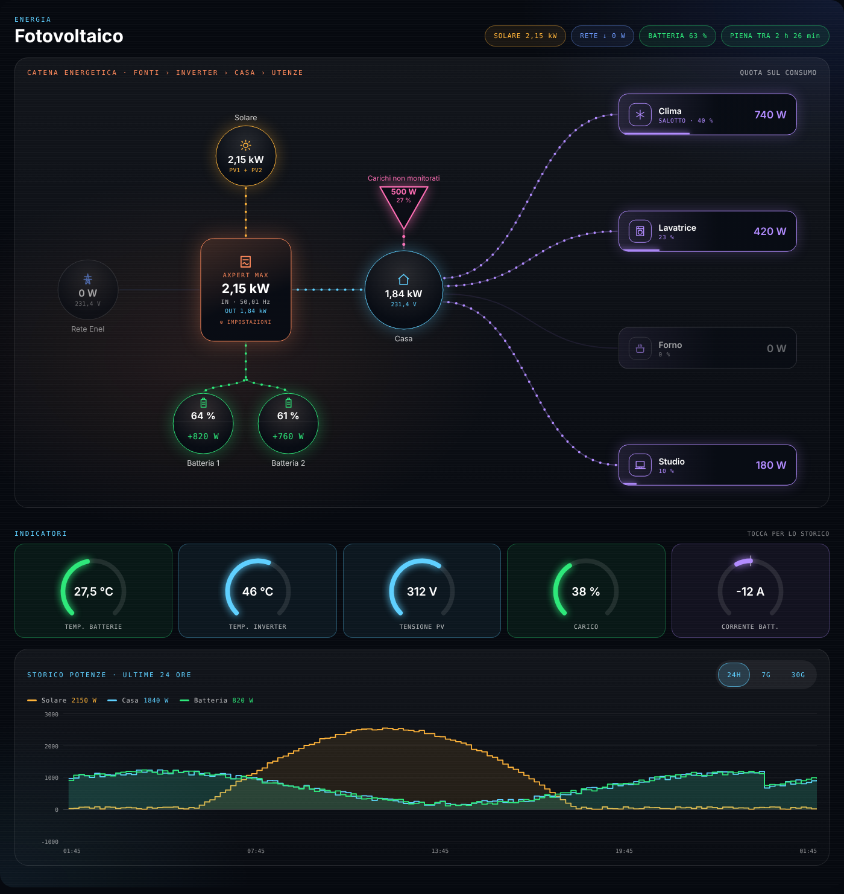
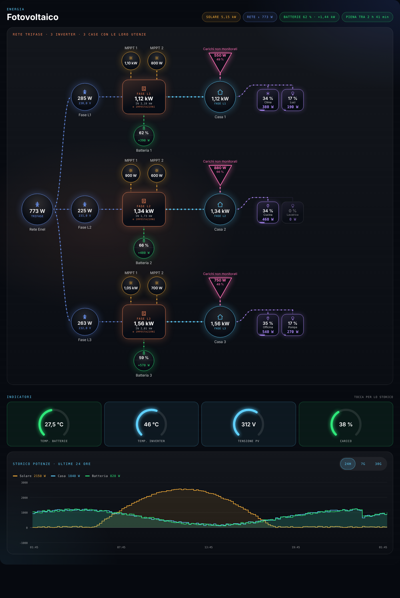

# FV HUD Card

Card Lovelace a tutta pagina per Home Assistant: monitoraggio del **fotovoltaico** in stile HUD, con flusso di energia animato, indicatori con soglie colorate, storico e pannello di controllo dell'inverter **Axpert** (o di qualsiasi inverter che esponga entità `select`, `number` e `switch`).




## Funzioni

- **Flusso di energia animato**: solare → inverter → casa, rete, una o due batterie e fino a 10 utenze, con la quota di ciascuna sul consumo.
- **Singolo o multi inverter**: modalità con un inverter (1-2 MPPT, 1-2 batterie) oppure fino a 3 inverter, uno per fase.
- **Popup con grafico** per ogni cerchio e utenza: potenza, tensione, corrente e carica (SOC).
- **Tempo stimato** di carica completa o di scarica fino alla carica residua desiderata (imposta la capacità del pacco batterie).
- **Indicatori** (fino a 18): anelli o tessere con barra, colori a soglie, scale che attraversano lo zero (es. correnti).
- **Storico** al tocco su qualsiasi indicatore o utenza (24 ore, 7 e 30 giorni), con tooltip.
- **Grafico storico potenze** a più serie (fino a 6).
- **Pannello inverter**: impostazioni (`select` / `number`), interruttori e letture, con **PIN** opzionale e blocco automatico.
- **Editor visuale completo**: non serve scrivere YAML.
- Adattiva: schermo largo, tablet e telefono.

## Installazione

### Con HACS (consigliata)

1. HACS → menu ⋮ → **Repository personalizzati**.
2. Incolla `https://github.com/Memme1989/fv-hud-card`, categoria **Dashboard** (o *Lovelace*), poi **Aggiungi**.
3. Cerca **FV HUD Card** e premi **Scarica**.
4. Ricarica il browser (Ctrl+F5).

### Manuale

1. Scarica `fv-hud-card.js` dall'ultima [release](https://github.com/Memme1989/fv-hud-card/releases) e copialo in `/config/www/`.
2. Impostazioni → Dashboard → ⋮ → **Risorse** → aggiungi `/local/fv-hud-card.js` come **Modulo JavaScript**.
3. Ricarica il browser.

## Uso

Aggiungi una card manuale con `type: custom:fv-hud-card`, poi configurala dall'editor visuale. Esempio minimo in YAML:

```yaml
type: custom:fv-hud-card
title: Fotovoltaico
subtitle: ENERGIA
solar:
  entity: sensor.pv_power
grid:
  entity: sensor.grid_power
  voltage_entity: sensor.grid_voltage
battery:
  entity: sensor.battery_power
  soc_entity: sensor.battery_soc
  charging_positive: true
  capacity_kwh: 10.24
  min_soc: 20
home:
  entity: sensor.home_power
loads:
  - entity: sensor.clima_power
    name: Clima
    icon: snow
indicators:
  - entity: sensor.battery_temperature
    name: Temp. batterie
    min: 0
    max: 60
    color: "#2ee87a"
    thresholds:
      - value: 35
        color: "#ffb43a"
      - value: 45
        color: "#ff5a5a"
axpert:
  title: Axpert Max
  controls:
    - entity: select.output_source_priority
    - entity: number.max_charging_current
  switches:
    - entity: switch.buzzer
  readings:
    - entity: sensor.inverter_mode
  lock:
    enabled: true
    pin: "1234"
    seconds: 30
history:
  series:
    - entity: sensor.pv_power
      name: Solare
      color: "#ffb43a"
```

### Opzioni principali

| Sezione | Cosa configura |
|---|---|
| `solar`, `grid`, `home` | Entità di potenza (W o kW). `grid` accetta anche tensione e frequenza. |
| `battery`, `battery2` | Potenza e carica (%). `charging_positive: false` se il tuo sensore ha il segno invertito. Con `battery2` compaiono due batterie affiancate. |
| `loads` | Utenze con icona, nome e testo secondario (o entità secondaria, es. umidità). |
| `indicators` | Entità con `min`, `max`, `unit`, `decimals` e soglie «da questo valore in su». `indicators_look: tiles` per le tessere. |
| `axpert` | Impostazioni, interruttori, letture e PIN. |
| `history` | Serie, intervalli (`24h`, `7g`, `30g`), altezza e stile (`look: areas`). |

Le entità di potenza possono essere in W o kW: la card converte da sola.

## Sicurezza del PIN

Il PIN serve a evitare tocchi involontari. **Non è una protezione di sicurezza**: resta scritto in chiaro nella configurazione della dashboard, visibile a chi può modificarla.

## Compatibilità

Funziona con qualsiasi integrazione che fornisca le entità: la card non dipende da una integrazione specifica per Axpert. Versione corrente: 1.23.0. Il numero compare anche nell'editor, nella sezione «Informazioni».

## Problemi e suggerimenti

Apri una [issue](https://github.com/Memme1989/fv-hud-card/issues) indicando versione di Home Assistant, versione della card e, se puoi, uno screenshot.

## English

FV HUD Card is a full-page Lovelace card for Home Assistant that shows a photovoltaic system as an animated HUD: energy flow (solar, inverter, grid, up to two batteries, up to 10 loads), colour-coded indicators, history on tap, a multi-series power chart, and an inverter control panel (selects, numbers, switches, readings) with an optional PIN. Install via HACS as a custom repository (category *Dashboard*) and configure everything from the visual editor. The interface is currently in Italian.

## Supporta il progetto

Se la card ti è utile, puoi offrirmi un caffè:

[](https://www.paypal.me/Memme198926)

## Licenza

MIT, vedi [LICENSE](LICENSE).
